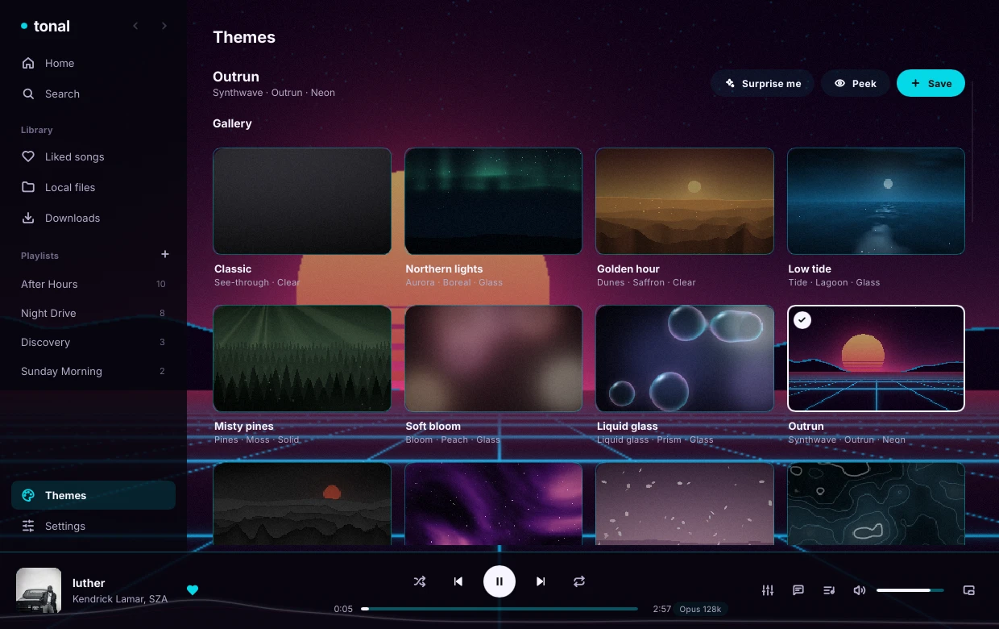
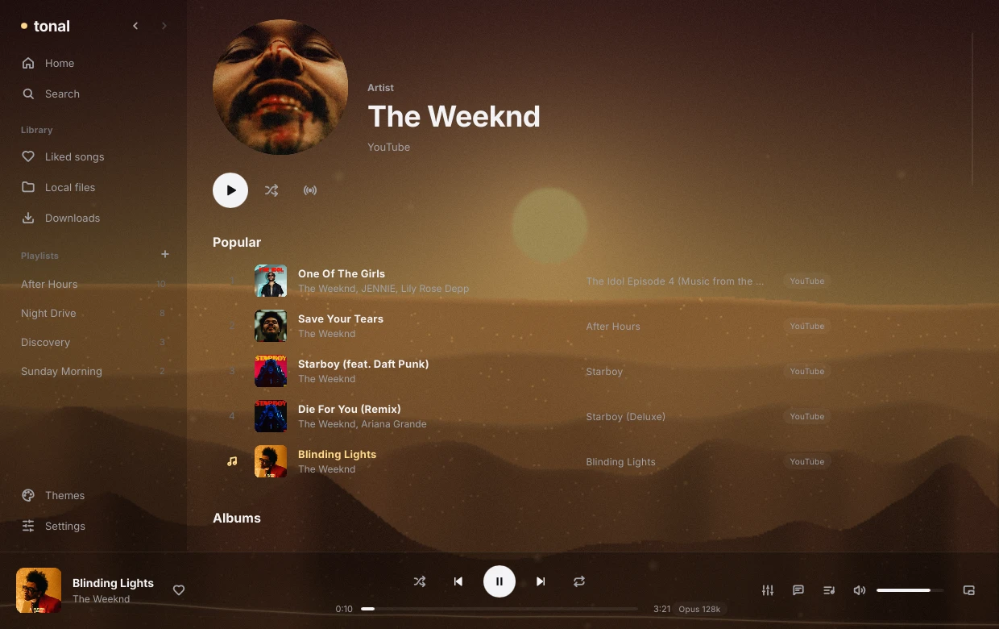
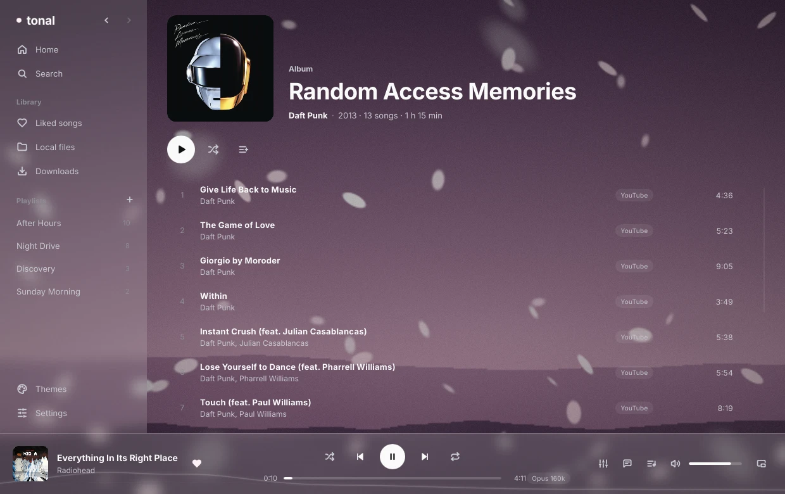
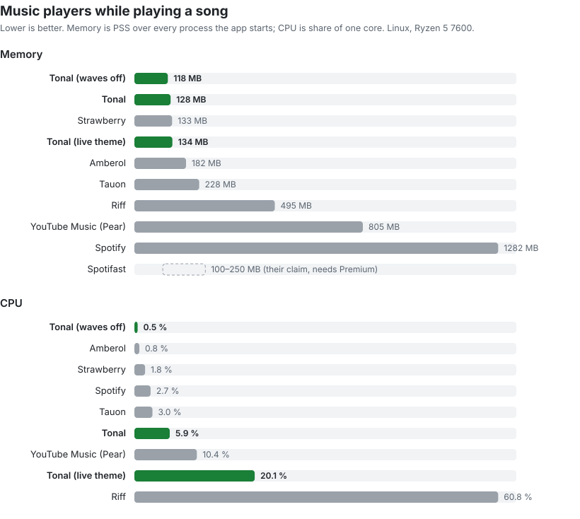

<div align="center">

# tonal

[](https://github.com/sjdsjadjajdjsa/tonal/actions/workflows/ci.yml)
[](LICENSE)
[](#install)
[](https://www.rust-lang.org)
[](https://mpv.io)

A lightweight native music player. Search and stream from YouTube Music, SoundCloud and Audius, play your own files, and bring your Spotify playlists along. No browser inside, no Premium, near zero CPU when idle.

<a href="https://slint.dev"><picture><source media="(prefers-color-scheme: dark)" srcset="https://raw.githubusercontent.com/slint-ui/slint/master/logo/MadeWithSlint-logo-dark.svg"></picture></a>


</div>

Most music apps are a web browser in disguise. Tonal draws its own window with [Slint](https://slint.dev) and hands the audio to [mpv](https://mpv.io), so it idles at 0% CPU and about 33 MB of memory, and stays around 5% of one core while playing with the visualizer on.

## What you get

- **Artists and albums:** click any artist or album name to open its page: photo, popular songs, albums, singles and similar artists, or an album with every track. Back and forward work with the arrows, Alt+←/→ and the mouse side buttons.
- **One search, four sources:** YouTube Music, SoundCloud, Audius and your local files. YouTube results come straight from YouTube Music, in under a second.
- **Your library:** liked songs, playlists, play history, most played, and a queue you can reorder. The queue and position come back when you reopen the app.
- **Spotify import:** paste a public playlist or album link and Tonal finds every song on YouTube Music (up to 100 songs). Log in with a free Spotify developer app for bigger playlists and your liked songs. Spotify audio itself is never used.
- **Now playing:** click the cover in the player bar (or `Ctrl` `N`) for a big cover, the waves and synced lyrics.
- **Album grid:** browse your local files as albums, sorted by artist, year or recently added.
- **Listening stats:** your top artists and albums this month and of all time, on Home. They never leave your computer.
- **Album colors:** the waves and the equalizer take a soft color from the cover.
- **Living themes:** 15 animated background scenes (aurora, dunes, ocean tide, misty pines, liquid glass, synthwave, sakura petals, city rain and more), 18 color palettes, endless seed variants that can crossfade on a timer, four panel styles (Clear, Glass, Neon, Solid) and optional music reactivity. The default Classic look paints nothing and costs 0% CPU.
- **Flowing visualizer:** a soft wave across the bottom of the window that moves with the music. It only runs while something plays, and settles into a still line when you pause.
- **Equalizer:** drag six points on a smooth curve, or pick a preset. Hold the compare button to hear the song without it.
- **Good playback:** gapless, crossfade, volume levelling, shuffle and repeat, all done by mpv.
- **Radio:** when the queue runs out, Tonal keeps going with similar songs.
- **Synced lyrics** from [LRCLIB](https://lrclib.net), highlighted line by line.
- **Downloads** for offline listening, with tags and cover art.
- **Desktop integration:** media keys and MPRIS, so your keyboard, bar widgets and `playerctl` all work.
- **Mini player** and **scrobbling** to Last.fm and ListenBrainz.

## Screenshots

| Home | Themes |
| --- | --- |
|  |  |

| Search | Artist |
| --- | --- |
|  |  |

| Album | Queue |
| --- | --- |
|  |  |

| Settings | Mini player |
| --- | --- |
|  |  |

## Install

Download the newest version from [Releases](https://github.com/sjdsjadjajdjsa/tonal/releases/latest).

| | Download | Run |
| --- | --- | --- |
| **Linux** | `tonal-x86_64.AppImage` | Mark it executable (`chmod +x tonal-x86_64.AppImage`) and run it. yt-dlp is inside; install [mpv](https://mpv.io) from your package manager. Needs glibc 2.35 or newer (Ubuntu 22.04, Fedora 36, Arch and so on). `tonal-linux-x86_64.tar.gz` is the same as a plain folder. |
| **Windows** | `tonal-setup-x86_64.exe` | Run it. Installs for your user only, with no admin rights, and adds a Start menu entry. mpv and yt-dlp are inside. `tonal-windows-x86_64.zip` is the portable version: unzip it anywhere (a USB stick works) and run `tonal.exe`. It keeps the library, settings and cache in `data` and `cache` folders next to it. |
| **Arch Linux** | `packaging/aur/tonal/PKGBUILD` | From a clone of this repo: `cd packaging/aur/tonal && makepkg -si`. Builds from source and uses your system's mpv and yt-dlp. |
| **macOS** | `tonal-macos-arm64.dmg` | Open it and drag Tonal to Applications. The first time, right-click Tonal and pick Open, as the app isn't signed. Install the tools with `brew install mpv yt-dlp deno`. For Apple Silicon Macs on macOS 14.4 or newer. |

Windows will say the publisher is unknown, as the installer isn't signed: click "More info", then "Run anyway". The visualizer works on Linux, Windows and macOS; on Windows it needs Windows 10 21H2 or Windows 11 or newer.

Any build turns portable when a file named `portable` or a folder named `data` sits next to the program: the library and settings then go to `data` and the cache to `cache` in that folder.

To build Tonal.app on macOS yourself, run `sh packaging/macos/build-app.sh` from a clone of this repo. It builds the app and puts it in Applications. Run `sh packaging/macos/setup-signing.sh` once before that, so macOS keeps Tonal's permissions (Full Disk Access, audio, Keychain) after each rebuild. The first time a song plays, macOS asks to let Tonal listen to its audio for the visualizer.

For full YouTube support yt-dlp needs a JavaScript runtime: install [Deno](https://deno.com) or Node.js. Tonal picks up whichever it finds. With Deno, Tonal also sets up the [bgutil PO Token provider](https://github.com/Brainicism/bgutil-ytdlp-pot-provider) for yt-dlp on first launch (about 70 MB in its cache folder, no server). When YouTube still refuses a song ("Sign in to confirm you're not a bot"), Tonal retries it with other player clients, then over IPv4, then with and without browser cookies, and remembers what worked. If YouTube blocks your network outright, only Use browser login (a signed-in browser) or another network gets through. The visualizer on Linux needs PipeWire (`pw-record`, `pw-dump`).

## Build it yourself

Needs [Rust](https://rustup.rs) 1.90 or newer, plus mpv and yt-dlp on your `PATH`. On Debian or Ubuntu you also need `libsqlite3-dev libdbus-1-dev libfontconfig-dev libxkbcommon-dev`.

```
git clone https://github.com/sjdsjadjajdjsa/tonal
cd tonal
cargo run --release
```

`cargo test` runs the tests, including real playback through mpv on a silent output.

## Keys

| Key | Does |
| --- | --- |
| `Space` | Play or pause |
| `Ctrl` `F` | Search |
| `Ctrl` `←` `→` | Previous, next |
| `←` `→` | Seek 5 seconds |
| `Ctrl` `↑` `↓` | Volume |
| `Ctrl` `L` | Like the current song |
| `Ctrl` `M` | Mini player |
| `Ctrl` `N` | Now playing, `Esc` to go back |
| `Alt` `←` `→` | Back, forward |

Right-click a song for play next, add to queue, start radio, download and add to playlist.

## If YouTube asks you to sign in

YouTube sometimes answers "Sign in to confirm you're not a bot", mostly after a lot of plays in a short time. Open **Settings → YouTube → Use browser login** and type the browser where you're signed in to YouTube (`firefox`, `chromium`, `brave`, `chrome`). Tonal then passes that browser's cookies to yt-dlp. On macOS, also turn Tonal on in System Settings → Privacy & Security → Full Disk Access, and pick Always Allow when the Keychain asks, so yt-dlp can read the browser's login. SoundCloud, Audius and local files keep working either way.

## Benchmarks

<picture>
  <source media="(prefers-color-scheme: dark)" srcset="docs/images/benchmark-dark.svg">
  
</picture>

Every player was measured the same way by [`bench/bench.py`](bench/bench.py): start it fresh, wait 30 seconds, then play a song into a silent output and measure 30 seconds of it, twice, and take the median. Memory is PSS summed over every process the app starts (mpv for Tonal, the browser processes for Electron apps), so shared libraries count once. CPU is the share of one core. Arch Linux, Hyprland, Ryzen 5 7600, October 2026.

| | Memory playing | CPU playing | CPU before playing | Plays |
| --- | --- | --- | --- | --- |
| **Tonal (waves off)** | 117 MB | 0.5% | 0.0% | same as Tonal |
| **Tonal** | 120 MB | 6.2% | 0.1% | YouTube, SoundCloud, Audius, local |
| Strawberry | 133 MB | 1.8% | 0.6% | local files |
| Amberol | 182 MB | 0.8% | 0.9% | local files |
| Tauon | 228 MB | 3.0% | 0.6% | local files |
| Riff | 495 MB | 60.8% | 32.2% | YouTube Music, SoundCloud, local |
| YouTube Music (Pear) | 805 MB | 10.4% | 12.7% | YouTube Music |
| Spotify | 1282 MB | 2.7% | 49.0% | Spotify |
| Spotifast | 100–250 MB (their claim) | not measured | not measured | Spotify, Premium only |

- Versions: Tonal 0.2.0 (this repo), Spotify 1.3.4, Riff 43.2.2 and YouTube Music (Pear) 3.12.0 from their AppImages, Strawberry 1.2.31, Amberol 2026.1 and Tauon 13.1.0 from Flathub.
- Strawberry, Amberol and Tauon play a local MP3. The others stream, which costs more.
- Tonal's waves cost about 5.5% of one core, because the window is redrawn by the CPU 30 times a second. Turn them off in Settings and Tonal is the lightest player measured here.
- [Spotifast](https://github.com/crmne/spotifast) states "100–250 MB of RAM" in its README, and playback needs Spotify Premium, so it isn't measured here.
- "Before playing" is the 15 seconds right after the 30-second wait, with the app open and nothing playing.

## How it works

- `src/player`: the playback engine. One mpv process over JSON IPC (a second one only during crossfades), with its own queue, shuffle history and gapless prefetch.
- `src/sources`: YouTube Music (InnerTube), SoundCloud (yt-dlp), Audius (public API), local files (lofty), radio, matching and downloads.
- `src/library`: SQLite for tracks, likes, playlists, history, settings and the saved session.
- `src/integrations`: Spotify import, LRCLIB lyrics, Last.fm and ListenBrainz.
- `src/visualizer`: reads Tonal's own audio (PipeWire on Linux, WASAPI process loopback on Windows, a Core Audio process tap on macOS), runs an FFT and turns it into smooth wave paths.
- `ui/`: the Slint interface.

[docs/architecture.md](docs/architecture.md) has the details.

## License

[MIT](LICENSE). Bundled programs keep their own licenses, see [THIRD-PARTY-NOTICES.md](THIRD-PARTY-NOTICES.md). The bundled [Inter](https://rsms.me/inter/) font is under the SIL Open Font License ([ui/fonts/Inter-LICENSE.txt](ui/fonts/Inter-LICENSE.txt)).

Tonal plays streams from public services through mpv and yt-dlp. Use it in line with the terms of those services.
