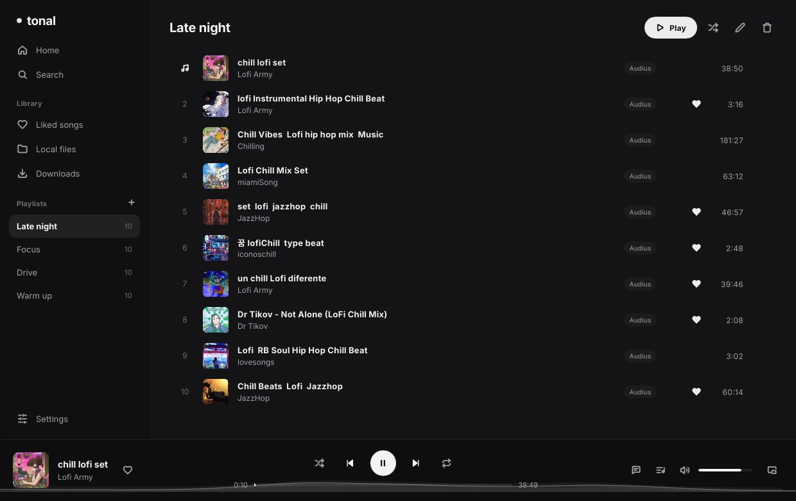
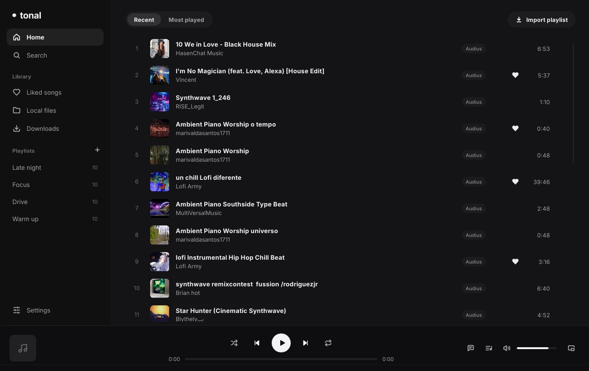
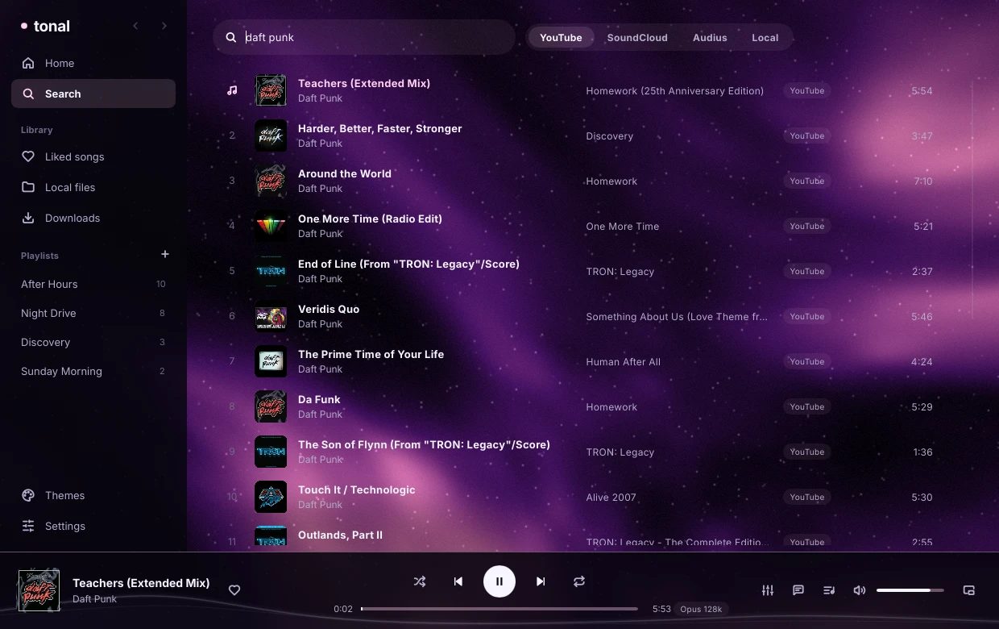
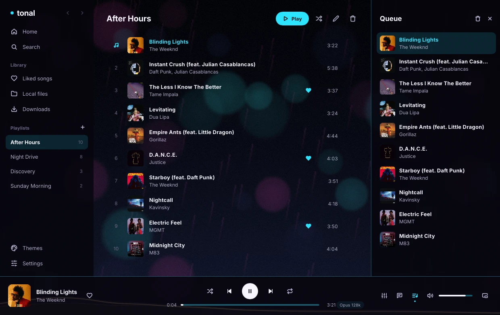
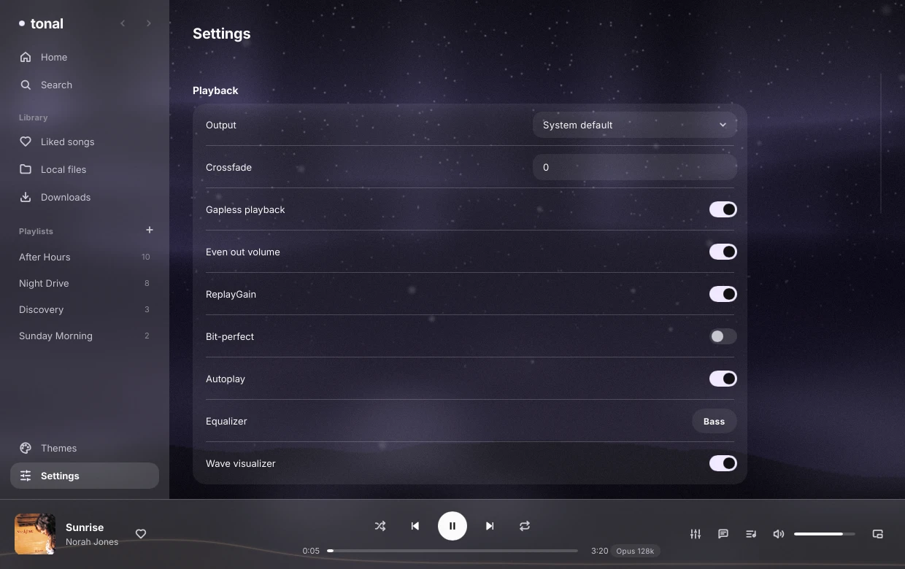
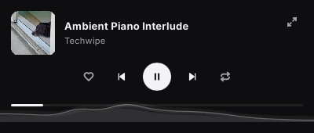

<div align="center">

# tonal

[](https://github.com/sjdsjadjajdjsa/tonal/actions/workflows/ci.yml)
[](LICENSE)
[](#install)
[](https://www.rust-lang.org)
[](https://slint.dev)
[](https://mpv.io)

A lightweight native music player. Search and stream from YouTube Music, SoundCloud and Audius, play your own files, and bring your Spotify playlists along. No browser inside, no Premium, near zero CPU when idle.



</div>

Most music apps are a web browser in disguise. Tonal draws its own window with [Slint](https://slint.dev) and hands the audio to [mpv](https://mpv.io), so it idles at 0% CPU and about 33 MB of memory, and stays around 5% of one core while playing with the visualizer on.

## What you get

- **One search, four sources:** YouTube Music, SoundCloud, Audius and your local files. YouTube results come straight from YouTube Music, in under a second.
- **Your library:** liked songs, playlists, play history, most played, and a queue you can reorder. The queue and position come back when you reopen the app.
- **Spotify import:** paste a public playlist or album link and Tonal finds every song on YouTube Music (up to 100 songs). Log in with a free Spotify developer app for bigger playlists and your liked songs. Spotify audio itself is never used.
- **Flowing visualizer:** a soft wave across the bottom of the window that moves with the music. It only runs while something plays, and settles into a still line when you pause.
- **Good playback:** gapless, crossfade, volume levelling, shuffle and repeat, all done by mpv.
- **Radio:** when the queue runs out, Tonal keeps going with similar songs.
- **Synced lyrics** from [LRCLIB](https://lrclib.net), highlighted line by line.
- **Downloads** for offline listening, with tags and cover art.
- **Desktop integration:** media keys and MPRIS, so your keyboard, bar widgets and `playerctl` all work.
- **Mini player** and **scrobbling** to Last.fm and ListenBrainz.

## Screenshots

| Home | Search |
| --- | --- |
|  |  |

| Queue | Settings |
| --- | --- |
|  |  |

**Mini player:** the controls and the visualizer in a small window.



## Install

Tonal is Linux only for now (Wayland and X11). Windows is planned.

It needs these on your `PATH`:

| Program | Why |
| --- | --- |
| [mpv](https://mpv.io) | Plays everything |
| [yt-dlp](https://github.com/yt-dlp/yt-dlp) | YouTube and SoundCloud streams, downloads |
| PipeWire (`pw-record`, `pw-dump`) | The visualizer (optional) |

On Arch: `sudo pacman -S mpv yt-dlp pipewire sqlite`. On Debian or Ubuntu: `sudo apt install mpv yt-dlp pipewire-bin libsqlite3-0`.

## Build it yourself

Needs [Rust](https://rustup.rs) 1.90 or newer. On Debian or Ubuntu you also need `libsqlite3-dev libdbus-1-dev libfontconfig-dev libxkbcommon-dev`.

```
git clone https://github.com/sjdsjadjajdjsa/tonal
cd tonal
cargo run --release
```

`cargo test` runs the tests, including real playback through mpv on a silent output.

## Keys

| Key | Does |
| --- | --- |
| `Space` | Play or pause |
| `Ctrl` `F` | Search |
| `Ctrl` `←` `→` | Previous, next |
| `←` `→` | Seek 5 seconds |
| `Ctrl` `↑` `↓` | Volume |
| `Ctrl` `L` | Like the current song |
| `Ctrl` `M` | Mini player |

Right-click a song for play next, add to queue, start radio, download and add to playlist.

## If YouTube asks you to sign in

YouTube sometimes answers "Sign in to confirm you're not a bot", mostly after a lot of plays in a short time. Open **Settings → YouTube → Use browser login** and type the browser where you're signed in to YouTube (`firefox`, `chromium`, `brave`, `chrome`). Tonal then passes that browser's cookies to yt-dlp. SoundCloud, Audius and local files keep working either way.

## Performance

Measured on the release build, Arch Linux, Hyprland, playing a stream with the visualizer on.

| | CPU | Memory |
| --- | --- | --- |
| Idle | 0% | about 33 MB |
| Playing | about 5% of one core, plus about 0.5% for mpv | about 46 MB |

The binary is about 21 MB. The software renderer was picked over the GPU one because it used a third of the memory at the same CPU. Nothing redraws while the app is idle, and the visualizer timer stops as soon as the waves settle.

## How it works

- `src/player`: the playback engine. One mpv process over JSON IPC (a second one only during crossfades), with its own queue, shuffle history and gapless prefetch.
- `src/sources`: YouTube Music (InnerTube), SoundCloud (yt-dlp), Audius (public API), local files (lofty), radio, matching and downloads.
- `src/library`: SQLite for tracks, likes, playlists, history, settings and the saved session.
- `src/integrations`: Spotify import, LRCLIB lyrics, Last.fm and ListenBrainz.
- `src/visualizer.rs`: reads Tonal's own audio from PipeWire, runs an FFT and turns it into smooth wave paths.
- `ui/`: the Slint interface.

[docs/architecture.md](docs/architecture.md) has the details.

## License

[MIT](LICENSE). The bundled [Inter](https://rsms.me/inter/) font is under the SIL Open Font License ([ui/fonts/Inter-LICENSE.txt](ui/fonts/Inter-LICENSE.txt)).

Tonal plays streams from public services through mpv and yt-dlp. Use it in line with the terms of those services.
